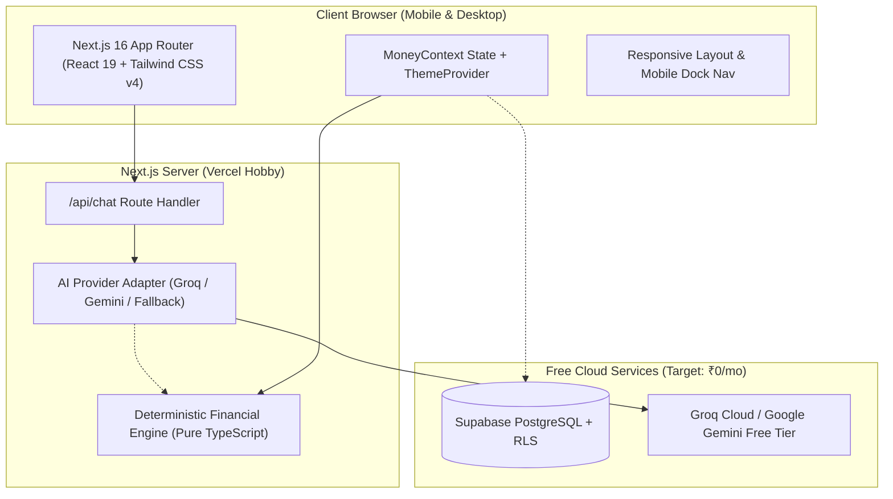

# Money Survival — AI-Powered Student Budgeting & Run-Out Forecast

> **Will your money survive until your next allowance, and exactly how much can you safely spend today?**

Money Survival is a calm, zero-guilt personal finance web app designed specifically for college students and young adults living on a fixed monthly stipend or allowance (e.g. ₹8,000/month).

Unlike traditional enterprise personal finance apps filled with net worth feeds and stock charts, Money Survival focuses on a single, vital objective: **preventing end-of-month financial panic** through a **100% deterministic mathematical forecasting engine** paired with a natural language **AI conversational logger**.

---

## Key Highlights

- **Money Survival Dashboard**: Real-time remaining balance, days to next allowance, safe daily spend limit ($S_{\text{safe}}$), and a plain-English survival prediction banner.
- **Deterministic Forecasting Engine**: 100% pure TypeScript arithmetic based on minor currency units (paise) to eliminate floating-point rounding bugs. **Zero LLM hallucination of financial math.**
- **Conversational Expense Logging**: Log expenses in everyday Indian student vernacular (e.g., *"spent 120 on auto"*, *"chai 30"*, *"actually that lunch was 150 not 200"*).
- **Graceful Fallback / Zero-Key Mode**: Works out-of-the-box with **₹0 required infrastructure cost**. Uses an offline deterministic regex parser when no external AI API key is configured.
- **What-If Purchase Simulator**: Instantly test whether you can afford an irregular purchase (e.g., ₹1,800 shoes) before spending, seeing its exact impact on your safe daily spend.
- **Smart Upcoming Obligations**: Automatically isolates predictable commitments (room rent, hostel Wi-Fi, recharge) and user safety reserves so you never accidentally spend them.
- **Contextual Real-time Alerts**: Early warning alerts when spending velocity exceeds safe thresholds or when a bill is due within 48 hours.
- **Calm, High-Contrast Dark & Light Mode**: Accessible, eye-friendly design adhering to zero-guilt student budgeting aesthetics.

---

## System Architecture



---

## Deterministic Mathematical Formulation

All ledger balances and forecasts are computed deterministically without floating-point math:

1. **Integer Minor Units (Paise)**:
   $$\text{paise} = \text{round}(\text{rupees} \times 100)$$

2. **Ledger-Derived Available Balance ($B_{\text{current}}$)**:
   $$B_{\text{current}} = B_{\text{opening}} + \sum(\text{Income} + \text{Refunds}) - \sum(\text{Expenses})$$

3. **Committed Obligations ($C_{\text{upcoming}}$)**:
   A bill is reserved if and only if it falls in the remaining window $[T_{\text{today}}, T_{\text{payout}})$ and has not already been marked paid this cycle.

4. **Discretionary Spending Pool ($M_{\text{discretionary}}$)**:
   $$M_{\text{discretionary}} = \max(0, B_{\text{current}} - C_{\text{upcoming}} - R_{\text{reserve}})$$

5. **Safe Daily Spending Limit ($S_{\text{safe}}$)**:
   $$S_{\text{safe}} = \begin{cases} \left\lfloor \frac{M_{\text{discretionary}}}{D_{\text{remaining}}} \right\rfloor & \text{if } D_{\text{remaining}} > 0 \\ M_{\text{discretionary}} & \text{if } D_{\text{remaining}} = 0 \end{cases}$$

---

## Free Cloud Deployment (Target: ₹0/month)

This application is engineered to run permanently within free-tier limits:

| Service | Provider | Free Tier Limit | Purpose |
| :--- | :--- | :--- | :--- |
| **Hosting & API** | [Vercel](https://vercel.com) | 100GB bandwidth, Serverless edge | Web app hosting & `/api/chat` |
| **Database** | [Supabase](https://supabase.com) | 500MB PostgreSQL, 50,000 MAUs | User profiles & transactions with RLS |
| **AI Extraction** | [Groq Cloud](https://groq.com) | Free rate limits (`qwen/qwen3.8-27b`) | Natural language parsing |
| **Keep-Alive** | [GitHub Actions](https://github.com) | 2,000 free minutes/month | Automated 4-day Supabase ping |

### Step 1: Deploy Database on Supabase

1. Create a free account at [supabase.com](https://supabase.com).
2. Create a new project (e.g. `money-survival`).
3. In the Supabase dashboard, navigate to **SQL Editor**.
4. Open [`supabase/migrations/001_initial_schema.sql`](supabase/migrations/001_initial_schema.sql) from this repository, paste its contents into the editor, and click **Run**.
5. Navigate to **Project Settings -> API** to copy:
   - `Project URL`
   - `anon public key`

### Step 2: Deploy Frontend on Vercel

1. Push this repository to your GitHub account.
2. Sign in to [Vercel](https://vercel.com) and click **"Add New Project"**.
3. Import your GitHub repository.
4. In the **Environment Variables** section, configure the following:
   ```env
   NEXT_PUBLIC_SUPABASE_URL=https://your-project.supabase.co
   NEXT_PUBLIC_SUPABASE_ANON_KEY=your-supabase-anon-key
   AI_PROVIDER=groq
   GROQ_API_KEY=gsk_your_free_groq_api_key
   GROQ_MODEL=qwen/qwen3.8-27b
   ```
5. Click **Deploy**. Vercel will build and assign you a free `https://your-app.vercel.app` domain.

### Step 3: Prevent Supabase Inactivity Pause

Supabase pauses free tier databases after 7 consecutive days without traffic. To automate keep-alive:
1. In your GitHub repository, go to **Settings -> Secrets and variables -> Actions**.
2. Add secrets for `NEXT_PUBLIC_SUPABASE_URL` and `NEXT_PUBLIC_SUPABASE_ANON_KEY`.
3. The included workflow [`.github/workflows/keep-alive.yml`](.github/workflows/keep-alive.yml) runs automatically every 4 days at 00:00 UTC to ping the database at zero cost.

---

## Local Development Quickstart

### Prerequisites
- Node.js 18.17+ or 20+
- npm (or PowerShell `npm.cmd` on Windows)

### Installation

```bash
# 1. Clone repository
git clone https://github.com/your-username/ai-money-tracker.git
cd ai-money-tracker

# 2. Install dependencies
npm install

# 3. Configure local environment
cp .env.example .env.local

# 4. Start local development server
npm run dev
```

Visit [http://localhost:3000](http://localhost:3000) in your browser.

### Running Test Suite

```bash
# Run Vitest test suite (96 tests covering forecasting, dates, currency, and AI parsing)
npm test

# Run tests in watch mode
npm run test:watch
```

### Production Build Verification

```bash
# Compile optimized Next.js Turbopack production bundle
npm run build
```

---

## Technology Stack

- **Framework**: Next.js 16 (Turbopack, App Router)
- **UI Library**: React 19 + Tailwind CSS v4
- **Icons**: Lucide React
- **Testing**: Vitest (12 test suites, 96 unit & integration tests)
- **Database**: Supabase PostgreSQL with Row Level Security (RLS)
- **AI Engine**: Groq Cloud SDK / Google Gemini SDK with offline regex fallback

---

## License

MIT License — free for students, developers, and educators.
